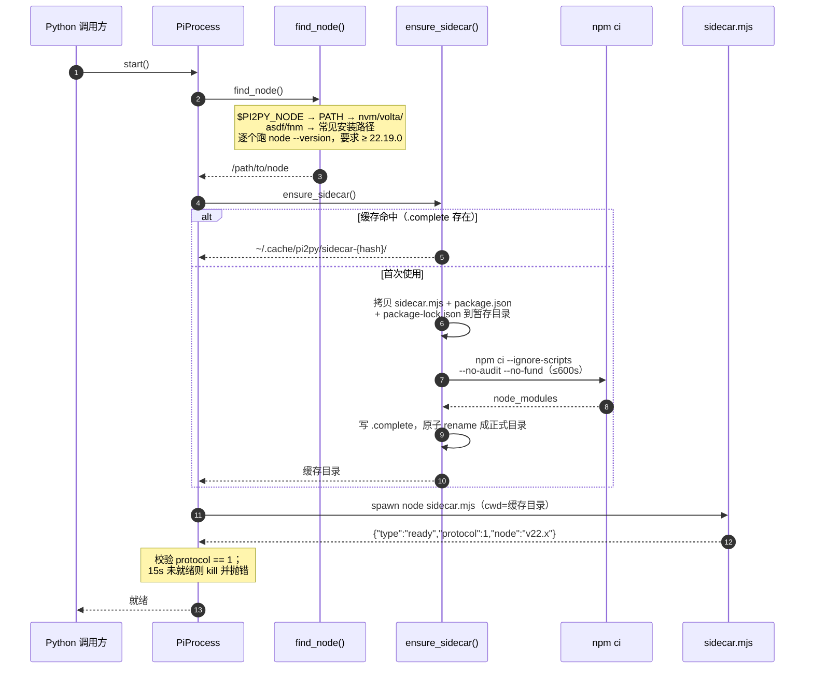
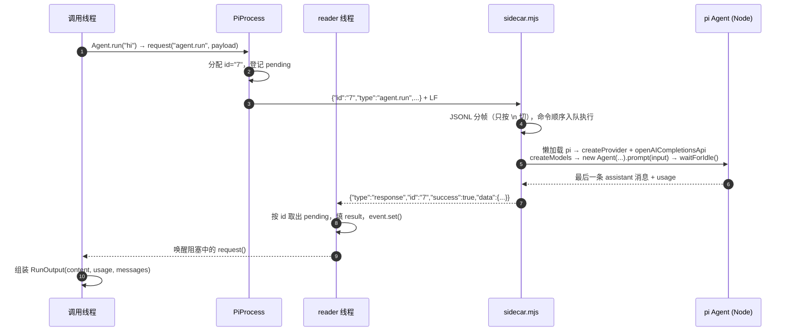
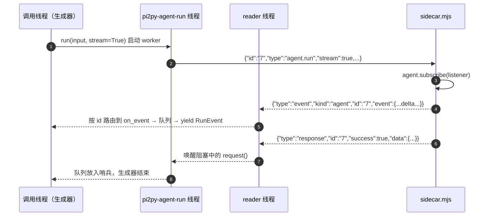
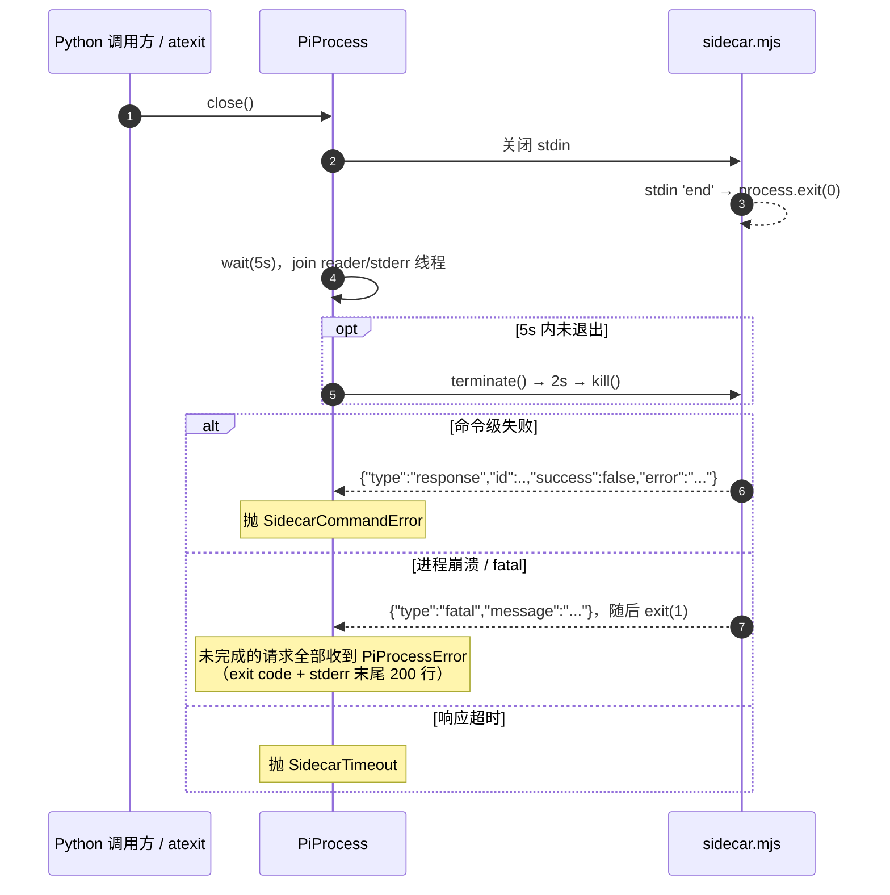

# Sidecar 机制

pi 的 agent 核心是一个 Node 包（`@earendil-works/pi-agent-core`）。pi2py 不做移植，而是随 wheel 自带一个 **Node sidecar** 脚本，Python 侧通过 stdio 上的 JSONL 协议驱动它。这样：

- pi 的能力（agent 循环、模型接入、未来的工具/steer）始终跟随上游，零转译成本；
- Python 门面保持纯同步（不需要 asyncio）——事件循环隔离在子进程里；
- 一个子进程一个 agent，互不干扰，崩溃被限制在进程边界内。

## 组件总览

| 组件 | 位置 | 职责 |
|---|---|---|
| sidecar 脚本 | `src/pi2py/node/sidecar.mjs`（随 wheel 分发） | Node 侧宿主：JSONL 帧解析、命令分发、装配 pi 的 `Agent`、转发流式 AgentEvent |
| 依赖清单 | `src/pi2py/node/package.json` + `package-lock.json` | 锁死 `pi-agent-core@1.3.0` / `pi-ai@1.3.0` 的依赖树 |
| Node 发现 | `pi2py/_node.py` | 找到 ≥ 22.19.0 的 Node 运行时 |
| 首次安装 | `pi2py/_install.py` | 拷贝 sidecar 到用户缓存并 `npm ci` |
| 传输层 | `pi2py/transport.py` (`PiProcess`) | 子进程生命周期 + JSONL 协议客户端（事件按请求 id 路由） |
| 门面 | `pi2py/agent.py` (`Agent`) | agno 风格 API，把调用翻译成 `agent.run` 命令 |
| 渲染 | `pi2py/render.py` (`RunPrinter`) | rich 渲染流式 RunEvent（`print_response` 的引擎） |

## 启动：找 Node → 装依赖 → 握手

`PiProcess.start()` 做三件事：

1. **`find_node()`**：定位一个 Node ≥ 22.19.0（pi 的要求）。搜索顺序：
   `$PI2PY_NODE`（设了就只认它）→ `PATH` → nvm（取最新）→ volta → asdf shim → `/usr/local/bin`、`/usr/bin`、`/opt/homebrew/bin` → fnm（取最新）。每个候选跑 `node --version` 验证，结果按路径缓存；全部失败时抛 `NodeNotFoundError`，错误信息列出每个候选被拒绝的原因。
1. **`ensure_sidecar()`**：缓存目录 `~/.cache/pi2py/sidecar-<hash>/`（`hash` 是随 wheel 分发的三个文件 sidecar.mjs + package.json + package-lock.json 的内容哈希前 12 位，任一变化就自动换目录重装——只看锁文件的话，升级后缓存里会跑旧 sidecar 脚本）。命中 `.complete` 标记直接返回；否则把 wheel 内的三个文件拷进暂存目录，`npm ci --ignore-scripts --no-audit --no-fund`（600s 超时），写 `.complete` 后原子 rename 成正式目录。并发安装靠 rename 竞态裁决：输了的一方发现目标已完整就直接复用。
1. **握手**：spawn `node sidecar.mjs`（cwd 为缓存目录），sidecar 自检 Node 版本后回发 `ready` 记录（协议版本 + Node 版本）。Python 校验协议号必须等于 1，15 秒超时或版本不符则 kill 进程并报错。

!!! note
`$PI2PY_SIDECAR_DIR` 可覆盖缓存目录（测试与多项目共享一份安装）；`$PI2PY_NODE` 可钉死 Node 路径。两者都来自 `Pi2pyConfig`（pydantic-settings）。

## 协议

协议仿 pi 自己的 RPC 模式（`packages/coding-agent/docs/rpc.md`），三条不变量：

- **stdout 只走协议**。一条 JSON 一个记录，严格 LF 分帧（CRLF 仅在收端容忍）。诊断一律走 stderr——两端的 JSON 解析器都**不许用 readline**，因为它还会按 U+2028/U+2029（JSON 字符串里合法）切行。
- **按 id 关联，不按顺序**。请求带字符串 `id`，响应回显它；Node 侧命令是顺序执行的，但响应天然可能交错，Python 侧用 `id → pending` 表 + `threading.Event` 做异步匹配。
- **关 stdin 即优雅退出**。sidecar 收到 stdin `end` 就 `exit(0)`。

### 记录类型（sidecar → Python）

| `type` | 含义 | Python 侧处理 |
|---|---|---|
| `ready` | 握手：协议版本 + Node 版本 | 校验 protocol == 1，放行 `start()` |
| `response` | 某 id 请求的应答（`success` + `data`/`error`） | 按 id 弹出 pending，唤醒等待线程 |
| `event` | 异步事件流：测试事件，或 `agent.run` 流式转发的 AgentEvent（回显请求 `id`） | 回显在途请求 id 的交给该请求的 `on_event`，其余走构造时的全局 `on_event`，都在 reader 线程内回调 |
| `fatal` | 进程级致命错误（uncaughtException 等） | 记录并使 `start()` 抛错；存活中的请求收到 `PiProcessError` |

请求方向只有一种记录：`{"id": "...", "type": "<命令>", ...payload}`。

### 一次请求：`Agent.run()` 的完整回路

要点：

- pi 包在 sidecar 里**懒加载**——`ping` 启动时很轻，首次 `agent.run` 才 import。
- provider 装配完全照搬 models.json 自定义条目：`createProvider` + `openAICompletionsApi()`，`compat` 原样透传给每个模型。
- 命令内的异常（provider 配置错误、网络、模型报错）被 sidecar 捕获，变成 `success:false` 的响应——命令失败不会杀进程；只有 uncaughtException / unhandledRejection 才发 `fatal` 并退出。
- **同一个 sidecar 的命令是串行执行的**。默认每个 `Agent` 独占一个 sidecar 进程；多 Agent 共享一个 `PiProcess` 时，长命令（如 `agent.run`）会阻塞后续命令。

### 流式运行：`agent.run` + `stream: true`

请求带 `stream: true` 时，sidecar 给 pi 的 `Agent` 挂一个 `subscribe` 监听器，把每个 AgentEvent 转成 `event` 记录（带 `kind:"agent"`、回显请求 id）发给 Python，**最后才发 response**。`message_update` 事件只转发 delta（事件自带的 partial 是「到目前为止的完整消息」，整条转发是 O(n²) 字节）；`message_end` 会带回完整消息，状态在消息边界自然对齐。

Python 侧 `Agent.run(input, stream=True)` 返回生成器：后台线程阻塞在 `request(..., on_event=...)` 上，reader 线程按 id 把事件塞进队列，生成器从队列里逐个 `yield RunEvent`；response 到达后队列放入哨兵，生成器结束（命令失败则在 drain 完事件后抛出）。`print_response()` 就是消费同一个流，用 `render.py` 的 `RunPrinter`（rich）渲染：dim 思考流 + Live markdown，思考不落最终输出。

## 退出与故障

工程细节：

- **优雅退出**：`close()` 关 stdin（sidecar 自行退出），等 5s，不行就 `terminate()`，再 2s 后 `kill()`。幂等，可重复调用。
- **退出兜底**：所有活着的 `PiProcess` 注册在一个 `weakref.WeakSet` 里，`atexit` 钩子在解释器退出时逐个 `close()`，避免留下孤儿 Node 进程。
- **崩溃检测**：stdout 流 EOF（reader 线程退出）即判定死亡，所有在途请求立刻收到 `PiProcessError`，错误信息带上退出码和 stderr 末尾若干行——通常是定位问题的关键。
- **stderr 环形缓冲**：sidecar 的诊断输出保存在最近 200 行的环形缓冲里，不刷屏但出错时拿得到。
- `Agent` 上下文管理器退出时关闭自己拥有的进程；共享传入的 `PiProcess` 则不动它。

## 错误类型速查

| 异常 | 场景 |
|---|---|
| `NodeNotFoundError` | 找不到 ≥ 22.19.0 的 Node |
| `SidecarInstallError` | `npm ci` 失败/超时，或 npm 找不到 |
| `PiProcessError` | 未启动、已死亡、启动超时、协议不匹配、进程消失 |
| `SidecarCommandError` | 命令被 sidecar 拒绝或执行报错（`success:false`） |
| `SidecarTimeout` | 超时未收到响应 |

## 命令一览

| 命令 | 用途 |
|---|---|
| `ping` | 探活，返回 Node 版本 |
| `echo` | 回声，传输层测试 |
| `selfcheck` | 验证 npm 安装的 pi 包真的能加载 |
| `emit-test-event` | 发一条 `event` 记录（回显请求 `id`），测试事件分发与按 id 路由 |
| `agent.run` | 跑一次 prompt 到结束；`stream: true` 时先转发流式 AgentEvent（`Agent` 门面使用） |
| `die` | 模拟崩溃（延迟按指定退出码退出） |

## 演进方向

当前是 M2 完成状态：`run()` 一次性返回，`run(stream=True)` 产出流式 `RunEvent`，`print_response()` 用 rich 渲染。M3 的 Python 远程工具靠**反向 RPC**（sidecar 发请求、Python 回响应，仍是 id 关联）。协议不变量（LF 分帧、id 关联、stdout 纯协议）对反向同样成立。
